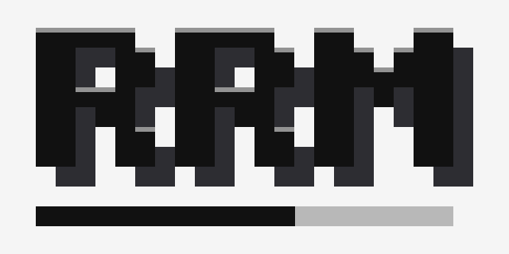

<p align="center"></p>

<p align="center"><a href="README.ru.md">Русская версия</a> · <a href="https://t.me/rrmnetwork">Telegram</a> · <a href="CHANGELOG.md">Changelog</a></p>

A Fabric client mod for Minecraft **26.3**, Java **25+**, mod version **27.2**. Obtain a random item as quickly as possible, alone or in a room with friends.

## Playing

- **Solo runs** with a random item target, optional custom seed, timer, history and personal records. A 5-second countdown starts automatically after the world loads.
- **Battles for 2–6 players** with optional passwords, a shared target and a synchronized start. Race in the host's shared world through built-in WebRTC or in separate worlds with the same seed.
- **Friends and global chat** in the Network panel. Add friends, see who's online and invite them directly into rooms.
- **Random Drop** randomizes block drops. **RRM Upgrader** (default key **U**) lets you stake items for a chance to win more valuable ones.
- **Voice control** for solo runs and rooms. After a one-time language pack download, recognition runs locally in English, Russian or Ukrainian.
- **Streamer mode** lets you play as Zloy with his skin and voice lines, including in rooms.
- **Modern and Classic interfaces** with six color themes and a customizable HUD. Change styles in **Settings → Interface Settings → Interface**.
- **Online and offline play.** Play solo without an account, or sign in for rooms, cloud history and leaderboards. The HUD shows whether a run is eligible for the leaderboard. Runs with Random Drop or voice control stay out of the rankings.

**Change seed** in the pause menu creates a new solo world, preserving the target, Random Drop and Upgrader. Available after the initial loading delay, even before the countdown ends.

## Installation

1. Install Minecraft **26.3**, Fabric Loader **0.19.5+**, Java **25+**, and Fabric API for 26.3.
2. Download [RandomRun 27.2](https://github.com/holodse-web/randomrunmod/releases/tag/v27.2), put `RandomRun-26.3Fabric-27.2.jar` in `mods` and remove older RandomRun JARs.
3. Use version **27.2** on every player's client. Shared worlds work through built-in WebRTC on Windows x64, Linux x64 and macOS (Intel and Apple Silicon).

## Build from source

Requires JDK 25. Run from the repository root.

```powershell
.\gradlew.bat build
```

The JAR is in `build/libs`.

## Links and license

[Telegram](https://t.me/rrmnetwork) · [License](LICENSE) · [Third-party notices](THIRD_PARTY_NOTICES.md)

Copyright (c) 2026 Stanislav Kholod. All rights reserved. Source is published for reference. Modification and redistribution of modified versions are prohibited. Modpack use is allowed with attribution.
