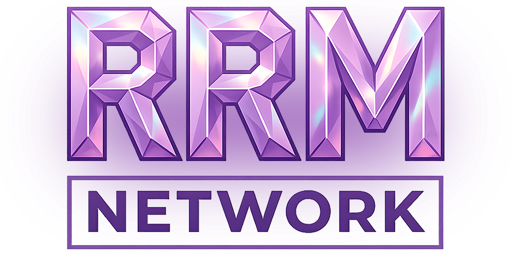

<p align="center">
  
</p>

# RandomRun Mod

<p align="center">
  <a href="https://github.com/holodse-web/randomrunmod/releases/latest"></a>
  
  
  
</p>

[Русская версия](README.ru.md)

**[Download latest release](https://github.com/holodse-web/randomrunmod/releases/latest)** · [27.0 release notes](https://github.com/holodse-web/randomrunmod/releases/tag/v27.0) · [Telegram](https://t.me/rrmnetwork)

**RandomRun** is a client-side Fabric mod for Minecraft **26.3** that turns survival into a speedrun challenge: you get a random target and race the clock, or race other players, to obtain it first.

| Mod version | Minecraft | Fabric Loader | Java |
| --- | --- | --- | --- |
| **27.0** | **26.3** | **0.19.5+** | **25+** |

## Game modes

### Solo speedrun

- Random target: an **item** or a **mob**, rolled with a slot-machine animation.
- Difficulty filter for the item pool; option to include or exclude unobtainable items.
- Custom world seed for practice or fair comparison.
- Precise run timer, run history with filters, and personal records.
- **RRM Upgrader** (new): bet up to 10 items (max 3 different types) on a chance wheel to roll a more valuable item. The bet value, target value and chance are calculated from item prices; the result is rolled once on the server side of the world. Press **U** (configurable) during a run.
- **Random Drop**: blocks drop random items. These runs do not count for the leaderboard.

### Battle

- 2 to 6 players, shared countdown, same target, ready indicators.
- **Separate worlds**: same seed, different worlds, fastest finish wins.
- **Shared world**: everyone plays in the host's world over [e4mc](https://modrinth.com/mod/e4mc) or Radmin VPN; last survivor or first to finish wins.
- Private rooms with a password and a public queue.
- Live notifications when opponents finish achievements or die.

### Online profile (optional)

- Account with password, global leaderboard and latest runs.
- Trust Score anti-cheat: clean runs raise it, cheats, creative mode and opening to LAN lower it.
- Everything works in **offline mode** without a profile.

## Interface and settings

- Redesigned menus with animations, particles and styled buttons.
- Drag-and-drop HUD editor, two HUD styles and two UI styles.
- Victory, defeat and draw screens with a **Repeat** button (same seed and target).
- Start by `/go` or a key of your choice, optional auto-deletion of finished worlds.
- Sound and music settings, AFK overlay, built-in version check.
- Languages: English, Русский, Українська.

## What's new in 27.0

[Read the full release notes →](https://github.com/holodse-web/randomrunmod/releases/tag/v27.0)

Highlights: port to Minecraft 26.3, RRM Upgrader, private-room password fix, safer version check, rendering optimizations.

## Installation

1. Install Minecraft **26.3** and [**Fabric Loader 0.19.5+**](https://fabricmc.net/use/installer/) (Java 25 or newer).
2. Download [**Fabric API** for 26.3](https://modrinth.com/mod/fabric-api/versions?g=26.3) and put it in your `mods` folder.
3. For shared-world battles install [**e4mc** for 26.3](https://modrinth.com/mod/e4mc/versions?g=26.3).
4. Download [`RandomRun-26.3Fabric-27.0.jar`](https://github.com/holodse-web/randomrunmod/releases/latest/download/RandomRun-26.3Fabric-27.0.jar), put it in your `mods` folder and remove older RandomRun versions.

[Releases](https://github.com/holodse-web/randomrunmod/releases/latest) also include `SHA256SUMS.txt` to verify your download. The **Source code** archives contain source files; use the JAR under Assets to play.

## Online features and data

In online mode the mod sends to its backend: nickname, a random player UUID, mod version, Trust Score and flags, a hashed hardware identifier used by the anti-cheat, and run results. The mod also scans installed mods and resource packs locally for known cheating tools; the outcome affects Trust Score. Choose **Play offline** in the main menu to avoid all of this.

## Building from source

Gradle, Java 25. Backend connection details are not part of this repository: copy `src/main/java/com/randomrun/network/FirebaseClient.java.example` to `FirebaseClient.java` and fill in your own endpoints.

In PowerShell, from the project root:

```powershell
.\gradlew.bat assemble             # plain JAR

.\gradlew.bat verifyObfuscatedJar  # ProGuard build and bytecode verification

```

The release JAR is written to `build/obfuscated/release/`. Keep `mapping.txt` locally for crash-log retracing.

## Links

Telegram: https://t.me/rrmnetwork

## License

Copyright (c) 2026 Stanislav Kholod. All rights reserved. The source is published for reference; modification and redistribution of modified versions are not permitted. Use in modpacks is allowed with attribution. See [LICENSE](LICENSE).
