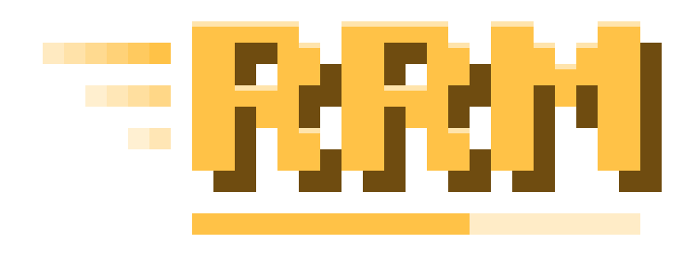

<p align="center"></p>

<p align="center"><a href="README.ru.md">Русская версия</a> · <a href="https://t.me/randomrunmod">Telegram</a> · <a href="CHANGELOG.md">Changelog</a></p>

A Fabric client mod for Minecraft **26.3**, Java **25+**, mod version **27.1**. Obtain a random item as quickly as possible, alone or in a room with friends.

## Playing

- Solo runs: item targets, optional custom seed, timer, run history and personal records. Start with `/go` or the configured key.
- **Random Drop:** randomized block drops. These runs are excluded from the leaderboard.
- **RRM Upgrader:** bet up to 10 items of up to 3 types for a chance at more valuable items, stacks and bonus streaks up to x32. Open with **U** (configurable). The integrated server decides the outcome; room hosts enable it for everyone.
- Rooms for **2–6 players** with optional passwords, a shared target and synchronized start. Play in the host's **shared world** through built-in WebRTC (the host must keep it running), or in **separate worlds** with the same seed.
- A player who wins a room by outlasting everyone, without obtaining the item, does not enter the leaderboard.
- Online profiles, history and leaderboards. Register with your launcher nickname; old database records are not imported.
- Fair play: cheat clients, X-ray packs, minimaps and speedrun helpers are blocked before a run.
- Offline solo play without an account. Rooms and cloud data require sign-in.
- Friends with requests, live status and room invites; invited friends skip the room password.
- HUD editor, interface/audio settings, six color themes, English/Russian/Ukrainian translations.

**Change seed** in the pause menu creates a new solo world, preserving the target, Random Drop and Upgrader. Available after the initial loading delay, even before `/go`.

## Installation

1. Install Minecraft **26.3**, Fabric Loader **0.19.5+**, Java **25+**, and Fabric API for 26.3.
2. Put `RandomRun-26.3Fabric-27.1.jar` in `mods` and remove older RandomRun jars.
3. Use the same mod version on every player's client. WebRTC is bundled for Windows x64, Linux x64 and macOS (Intel and Apple Silicon); e4mc and a VPN are not required.

## Online service

API: [randomrun-api.rrmnetwork-rooms.workers.dev](https://randomrun-api.rrmnetwork-rooms.workers.dev/v1/health). Its public address is configuration, not a credential.

The mod uses a Cloudflare Worker over HTTPS/WebSocket and a SQLite Durable Object for accounts, sessions, rooms, presence and signaling. Clients receive no database administrator credentials. Account and room passwords are salted and hashed server-side. Personal login tokens last up to 12 hours and stay in memory; password changes revoke previous sessions. Profile/history writes require ownership; room actions require membership and host privileges where applicable. Nickname registration does not verify Microsoft account ownership.

Minecraft traffic uses an ordered, reliable, encrypted WebRTC DataChannel between guests and the host, with Cloudflare TURN as a relay fallback. The master TURN key stays in Worker secrets; room members get short-lived credentials. The integrated server binds to loopback and checks Minecraft names against authenticated peers. Rooms/status reconnect after signaling outages; broken game connections require rejoining.

Online data: nickname, account ID, password/session hashes, profile settings/security reports, room state, connection metadata and submitted results. Mods and resource packs are checked locally for known cheat tools; client checks and submitted solo results cannot guarantee protection against modified clients. Offline mode does not use the online API.

### Hosting and cost

Workers and SQLite Durable Objects can use the free tier within request, duration and storage limits. The API runs independently; the world runs on the host's computer. Free capacity, uninterrupted availability and low latency across CIS/European networks are not guaranteed.

Cloudflare Realtime includes **1,000 GB/month** shared between TURN and SFU, then **$0.05/GB** of outbound traffic. TURN activation requires billing details. This project does **not** enforce a hard spending cap. Monitor Cloudflare usage before wider distribution. See [Realtime pricing](https://developers.cloudflare.com/realtime/sfu/platform/pricing/), [Workers limits](https://developers.cloudflare.com/workers/platform/limits/) and [Durable Objects pricing](https://developers.cloudflare.com/durable-objects/platform/pricing/).

Without TURN secrets, rooms, presence and direct WebRTC work, but some NATs/firewalls prevent game connections.

## Development

Requires Java 25, Node.js 22+ and npm.

```powershell
.\gradlew.bat build
.\gradlew.bat obfuscatedJar
cd server
npm ci
npm run dev
```

For a local Minecraft client set JVM property `-Drandomrun.api=http://127.0.0.1:8787`. The packaged API address is in `src/main/resources/randomrun-online.json`; remote overrides require HTTPS.

Jars: `build/libs` (plain), `build/obfuscated/release` (obfuscated). The crash mapping in `build/obfuscated` is private: do not distribute it. Build tasks do not publish releases.

The Upgrader catalog is regenerated with `python tools/upgrader/generate_values.py C:/path/to/minecraft-26.3-client.jar`. Its resource is `src/main/resources/assets/randomrun/upgrader_values.json`; audits go to `build/reports/upgrader`.

### Deploying your own backend

1. Set your `account_id` and Worker name in `server/wrangler.jsonc`. From `server`, run `npx wrangler login` and `npm run deploy`.
2. Wrangler creates the SQLite Durable Object through the migration. Default object name `randomrun-v1` starts with an empty database. Optional server variable `HUB_NAME` selects an isolated database for deployment tests; changing it also changes which data is visible.
3. Optionally create a Cloudflare TURN app and run `npx wrangler secret put TURN_KEY_ID` and `npx wrangler secret put TURN_API_TOKEN`. Never put these values in Java code, public configuration or Git.
4. Update the mod's public API URL and rebuild. Credentials embedded in old clients must be revoked separately; source removal does not revoke issued keys.

## Links and license

[Telegram](https://t.me/randomrunmod). Copyright (c) 2026 Stanislav Kholod. All rights reserved. Source is published for reference; modification and redistribution of modified versions are not permitted. Modpack use is allowed with attribution. See [LICENSE](LICENSE).
