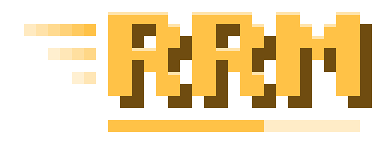

<p align="center"></p>

<p align="center"><a href="README.md">English version</a> · <a href="https://t.me/rrmnetwork">Telegram</a> · <a href="CHANGELOG.md">Список изменений</a></p>

Клиентский мод Fabric для Minecraft **26.3**, Java **25+**, версия **27.1**. Добывайте случайный предмет на время — в одиночку или в комнате с друзьями.

## Игра

- Одиночные забеги: цель-предмет, свой сид по желанию, таймер, история и личные рекорды. Старт через `/go` или выбранную клавишу.
- **Random Drop:** случайные предметы при разрушении блоков. Такие забеги не попадают в таблицу лидеров.
- **RRM Upgrader:** поставьте до 10 предметов не более 3 типов ради шанса получить более ценные вещи, стаки и бонусные серии до x32. Открывается на **U** (клавиша настраивается). Исход определяет встроенный сервер; в комнатах режим включает хост для всех.
- Комнаты на **2–6 игроков** с паролем по желанию, общей целью и синхронным стартом. Играйте в **общем мире** через встроенный WebRTC (хост должен держать мир запущенным) или **в отдельных мирах** с одинаковым сидом.
- Победа «по выживанию» в комнате, без добычи предмета, в таблицу лидеров не попадает.
- Онлайн-профиль, история и таблица лидеров. Регистрируйтесь с ником из лаунчера; данные старой базы не переносятся.
- Честная игра: чит-клиенты, X-ray паки, миникарты и помощники для спидрана блокируются перед забегом.
- Одиночная игра оффлайн без аккаунта. Комнаты и облачные данные доступны после входа.
- Друзья: заявки, статус в реальном времени и приглашения в комнату; приглашённым не нужен пароль.
- Редактор HUD, настройки интерфейса и звука, шесть цветовых тем, английский, русский и украинский языки.

**«Сменить сид»** в меню паузы создаёт новый одиночный мир, сохраняя цель, Random Drop и Upgrader. Доступно после начальной задержки загрузки, в том числе до `/go`.

## Установка

1. Установите Minecraft **26.3**, Fabric Loader **0.19.5+**, Java **25+** и Fabric API для 26.3.
2. Положите `RandomRun-26.3Fabric-27.1.jar` в `mods`, удалив старые версии RandomRun.
3. У всех участников должна быть одинаковая версия мода. WebRTC включён в сборку для Windows x64, Linux x64 и macOS (Intel и Apple Silicon); e4mc и VPN не требуются.

## Разработка

Нужны Java 25, Node.js 22+ и npm.

```powershell
.\gradlew.bat build
.\gradlew.bat obfuscatedJar
cd server
npm ci
npm run dev
```

Для тестового Minecraft задайте параметр JVM `-Drandomrun.api=http://127.0.0.1:8787`. Адрес готовой сборки находится в `src/main/resources/randomrun-online.json`. Удалённые адреса должны использовать HTTPS.

Обычный jar: `build/libs`, обфусцированный: `build/obfuscated/release`. Карта для разбора ошибок в `build/obfuscated` приватна: не распространяйте её. Задачи сборки не публикуют релиз.

Каталог Upgrader пересоздаётся командой `python tools/upgrader/generate_values.py C:/path/to/minecraft-26.3-client.jar`. Ресурс: `src/main/resources/assets/randomrun/upgrader_values.json`; отчёты: `build/reports/upgrader`.

## Ссылки и лицензия

[Telegram](https://t.me/rrmnetwork). Copyright (c) 2026 Stanislav Kholod. Все права защищены. Исходники опубликованы для ознакомления; изменение и распространение изменённых версий запрещены. Использование в модпаках разрешено с указанием авторства. См. [LICENSE](LICENSE).
